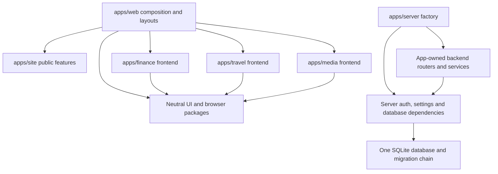

# Top-down refactor: one product, fewer active systems

This section incorporates the owner's expanded instruction: be aggressive about deletion, consolidation, developer experience, and coherent design; implement in one refactor PR using a swarm and XP feedback loops. It is the controlling architecture decision for the domain plans, not an additional independent project.

## Decision

Build one root Angular web application and workspace using the Angular stack already carrying the largest frontend. Compose lazy public, Hub/account, Finance, Travel and Media features. Keep one FastAPI application factory, one database engine/session lifecycle, one identity/session implementation and the existing unified SQLite migration chain. Keep domain code/data in its own app folder. Remove the parallel client and server bootstraps once their consumers migrate.

This is an aggressive consolidation, including porting Travel/Media presentation from custom ES-module HTML strings to ordinary Angular templates/forms/routes. Reuse useful pure domain logic and tests. Do not introduce React/Next/Vue, microfrontends, a generic resource engine, a generic repository layer or distributed services. Existing production already runs one backend/image/database: deployment unification itself is not the missing work.

The independent reviewers differed: one favored retaining native frontend stacks after shared tooling/shell cleanup to avoid churn; the second favored one Angular runtime to remove the handwritten UI framework. The owner's explicit request to reset the sewn-together architecture, combined with roughly 9.6k lines of Travel/Media modules and CSS and repeated shell/routing/state mechanisms, favors the single-runtime target. This is a reasoned target, not evidence that a port automatically saves lines. ARC-01 must prove it with working slices and measurements before the broad UI port begins. If evidence rejects the target, update this decision explicitly; do not quietly ship permanent hybrid machinery under a “temporary” label.

## Principles applied to actual code

| Principle | Current friction | Required change |
| --- | --- | --- |
| XP simple design / YAGNI | Standalone and unified auth/DB/startup paths coexist; future flexibility carries present cost. | One supported production/dev path; test injection replaces alternative deployable stacks. |
| High cohesion / clear ownership | Shared auth and Hub live under Finance; generic browser exports include Finance validators. | Suite identity/Hub move to composition/platform, Finance validators return to Finance, financial computation stays in Finance. |
| DRY at behavior level | Travel/Media duplicate session middleware, principal types, API clients, shell/theme/menu logic. | One concrete implementation with explicit consumers; no universal abstraction framework. |
| Explicit dependencies | Server mutates environment before imports, rebinds engines, copies routes/middleware by reflection/class name. | App factory takes validated settings/dependencies and explicitly includes routers. |
| Separation of concerns | Media read endpoints fetch discographies/art and mutate cache; client renders remote data as membership. | DB-only saved reads; explicit bounded enrich/explore; distinct personal membership and public metadata. |
| Small reversible steps | One giant renderer, appended CSS, source-string tests make changes brittle. | Vertical slices, behavioral fixtures, immediate old-path deletion, serial green integration. |
| Measure before optimize | Multiple toolchains/locks, unknown bundle/latency impact; LOC alone can mislead. | Baseline and compare active mechanisms, source/dependencies/build times/payloads/queries and journey steps. |

Refactoring and tests support YAGNI; they are not speculative feature work. [Fowler's YAGNI explanation](https://martinfowler.com/bliki/Yagni.html) makes this distinction. The bounded modular-monolith choice applies the cost reasoning in [Monolith First](https://martinfowler.com/bliki/MonolithFirst.html) to this small personal suite. XP's short test/feedback/integration cycle is described by [Agile Alliance](https://agilealliance.org/glossary/xp/).

## Target tree and dependency direction

```text
package.json / package-lock.json / angular.json / tsconfig*.json
apps/
  web/                         # composition, layouts, Hub, account, HTTP/session/theme
    src/main.ts
    src/app/routes.ts
    src/app/{public-layout,private-layout}/
    src/app/{hub,account,platform}/
  site/src/                    # public page features/assets + public-api.ts
  finance/
    frontend/src/              # financial routes/models/vault + public-api.ts
    backend/                   # vault/market domain routers/services/models
  travel/
    frontend/src/              # trip/calendar/PTO components + public-api.ts
    backend/                   # domain routers/services/models/providers
  media/
    frontend/src/              # library/search/item/progress components + public-api.ts
    backend/                   # domain routers/services/models/providers
  server/
    main.py                    # create_app(settings, dependencies), explicit composition
    auth/                      # shared identity/challenge/session/CSRF/account ownership
    database.py                # single engine/session lifecycle
    settings.py                # one validated settings source
    alembic/                   # one active unified migration chain
packages/
  ui/                          # neutral components/tokens
  browser/                     # neutral browser/crypto/format primitives
  auth/                        # genuinely shared pure identity primitives
  time/                        # neutral time boundaries
tests/e2e/                     # one config/harness; domain-grouped journeys
```

Only `apps/web` composes frontend feature public entrypoints. No feature imports a sibling's internals or the composition root. Packages never import apps. `apps/server` composes backend routers; domain routers consume server-owned platform dependencies. Implement a narrow declared platform/public-API exception in the boundary checker and tests; do not disable it or rely on aliases that bypass its scanner. Use TYPE_CHECKING/protocol boundaries only when they reduce actual coupling; avoid cyclic imports.

The target graph must be explicit: composition imports features; features use neutral packages and a small injected platform contract; backend domain modules use server platform modules that do not import domains. Server factory alone imports domain route exports. Split dependency modules from factory so “server auth imports Finance auth imports server database” cannot become a cycle.

Frontend contract location is explicit: add only the actually consumed framework-neutral `SessionSnapshot`/`SessionPort` types to `packages/auth/src/session-contract.ts`, exported by that package. Bind that port through a small Angular injection token in `packages/ui/src/session-context.ts`, exported by UI. The concrete session service and token provider live in `apps/web/src/app/platform`; features inject the neutral token, never import the implementation or `apps/web`. Keep the port limited to observed identity/session state and required actions, not provider/Finance/PTO policies. Use ordinary Angular HttpClient with root interceptors for credential/CSRF/error transport; do not create another platform-contract package or universal SDK. Generic theme/dialog primitives retain existing UI exports.



Browser features call their existing HTTP APIs; Finance financial records are decrypted/computed only in its browser feature. The diagram shows source ownership/dependencies, not permission for domains to read one another's private tables.

## ARC-01 — One-iteration architecture spike

- [ ] Capture current source/mechanism/dependency/build/browser metrics and critical behavior fixtures.
- [ ] One root production build renders public Home, shared sign-in/Hub, one guarded Finance page, Travel date editor and real map, and one Media library/search scene.
- [ ] Public initial download does not eagerly import FinanceService/VaultService/chart/crypto implementations. Finance AuthService currently injects FinanceService and VaultService; split session before moving it.
- [ ] Meaningful public title/heading/description/social metadata exists in generated public HTML. Inspect generated output; existing server-route config alone does not prove prerender is wired.
- [ ] Private pages contain no real user data in build/prerender output. Public pages never invoke authenticated data endpoints.
- [ ] Direct reload and legacy hash links work. Hash translation runs browser-side because fragments never reach the server.
- [ ] Use one private-document CSP with only required resource origins and Trusted Types. Browser CSP follows the loaded document, not Angular route changes.
- [ ] Treat public↔private layout entry as an explicit full-document navigation when their security policies differ; use the same compiled application with the correct response policy. Private app↔app navigation stays in one runtime. Alternatively use a single suitably strict common document policy proven for every route. Do not assume client navigation can upgrade a public document to a more permissive private image policy.
- [ ] Render real Leaflet controls, markers, popups and attribution under that policy. Leaflet itself has HTML sinks; replacing outer templates alone is insufficient. Use supported safe DOM interfaces or a narrowly reviewed compatible library path, with no permissive default trust policy.
- [ ] Vault unlock, navigation to Travel/Media, return, expiry/sign-out and cross-tab cleanup work with existing encrypted data format.
- [ ] Compare added/replaced source and active mechanisms. Demonstrate fewer routing/rendering/state paths for representative slices; record any bundle overhead honestly.
- [ ] Freeze public/private document policy and root route manifest after the spike. Remove throwaway code before domain ports.

Failure at this checkpoint triggers a focused incompatibility fix or an explicit revised architecture decision. It does not authorize weakening Trusted Types, dropping public SEO, or leaving all old runtimes supported indefinitely.

## Canonical route map

| Concern | Canonical browser routes | Ownership |
| --- | --- | --- |
| Public identity | `/`, `/work`, `/about`, `/secrets` | Site feature, public layout |
| Shared sign-in/account | `/auth/login`, `/auth/signup`, `/account`, `/hub/admin` | Web/platform |
| Workspace | `/hub` | Web |
| Finance | `/finance/` and feature child paths including vault setup/unlock | Finance feature |
| Travel | `/travel/`, `/travel/trips/new`, `/travel/trips/:id`, `/travel/calendar`, `/travel/pto`, `/travel/settings` | Travel feature |
| Media | `/media/`, `/media/library`, `/media/search`, `/media/item/:id`, episode/season/calendar/add routes | Media feature |

Keep current API prefixes initially: `/api/...`, `/travel/api/...`, `/media/api/...`. Renaming every API to `/api/v1/domain` adds migration work without a current benefit. A single client supports these ordinary paths. Consolidate compatibility redirects to a small manifest and one startup hash translator; delete custom routers and prefix gymnastics after cutover.

Finance `/` links currently mean Finance home; audit and convert them to feature-relative or `/finance/` routes. Do not redirect public root into Finance accidentally. Preserve tab query parameters, import receipt deep links, dates, safe auth return paths and compatibility bookmarks. Missing assets/API routes remain actual 404s, never SPA HTML with status 200.

## ARC-02 — Backend composition and ownership reset

- [ ] Create one explicit `create_app` factory with immutable settings, engine/session and optional test dependencies; avoid import-time engine creation and environment steering.
- [ ] Move shared identity/challenge/session/CSRF/account code and user ownership models out of Finance backend into server auth. Preserve exact challenge purpose, signing/key-wrap, rotation and rate-limit behavior.
- [ ] Domain routers receive the request session and principal explicitly. Remove duplicate Principal/AuthResult types, remote auth fallback and ambient actor plumbing once tests/harnesses migrate.
- [ ] Use one session unit of work and commit/rollback rule; inspect autoflush/expiration differences before replacing generators. Keep provider IO outside DB write transactions.
- [ ] Replace Finance app introspection/route-copy/middleware-name filters with named router exports. Register logging, security, rate limiting, CSRF and error handlers exactly once in tested order.
- [ ] Move startup schema checks to one root lifespan; migrations remain offline. Remove domain startup `create_all`, owner-column ALTER paths and silent fallback DB filenames from the production/import path.
- [ ] Preserve tenant ownership filters and foreign keys. Extracting shared identity must not make domain data globally readable.

## ARC-03 — Frontend/toolchain consolidation

- [ ] One root npm install/lock/workspace, one browser bootstrap/router, one release manifest and one frontend image build stage.
- [ ] Keep the working current Angular/tool versions during consolidation. No simultaneous framework-major, test-runner, state-library or package-manager migration without a demonstrated blocker.
- [ ] Public and private layouts share neutral primitives; lazy features keep local models/services. Root platform owns session, HTTP, theme and account; Finance owns vault lifecycle.
- [ ] Use existing Angular forms/components instead of porting string renderers into Angular innerHTML bindings.
- [ ] Move Finance-only validators out of `packages/browser/src/validators.ts`; keep generic primitives shared. Keep packages/auth only for actual common consumers.
- [ ] Consolidate lint/TypeScript/Karma configuration with per-domain discovery and coverage reports. Preserve the existing meaningful suites and floors during path migration.
- [ ] One Playwright harness boots the assembled app with disposable DB and synthetic auth/provider fixtures. Remove separate standalone servers after equivalent tests run against the root.
- [ ] Use one supported local command set and environment example. Delete unused package locks/install scripts only after all consumers move.

## DEL-ALL — Delete old runtime paths

Follow the [deletion ledger](15-deletion-ledger.md). Delete old Travel/Media renderer/router/theme/account/API dispatcher code after each feature's target passes. Delete old public/Finance Angular bootstraps/configs at root cutover. Remove full old ASGI app factories and duplicated DB/auth fallbacks after root harness migration. Preserve data and migration history; breaking internal APIs and reorganizing source are authorized, corrupting personal records is not part of the request.

## ARC-05 — Simplify hot paths

- [ ] DB-only saved library/detail reads with zero outbound provider calls.
- [ ] On-demand, bounded discography/photo/metadata refresh; delete eager full-catalog backfill and its resume branches if no actual remaining consumer.
- [ ] Search process cache bounded by TTL/count/bytes; no durable query history by default.
- [ ] Select relationship data in bounded queries; pagination must limit response payload and DB work, not just hide already-downloaded DOM rows.
- [ ] Per-day PTO calculation uses one canonical event stream; remove competing aggregate calculations after compatibility migration.
- [ ] Remove duplicated inline CSS overrides and unused controls after shared primitive adoption. Split files by real task boundaries rather than arbitrary line limits.

## What “extreme” and “atomic” mean here

Be willing to delete unused features/infrastructure paths, change internal APIs, move ownership and replace entire redundant presentation layers. Preserve the requested user stories, user records, encryption and test strength. Do not spend effort maintaining unneeded standalone deployment modes.

One PR is the delivery unit. Within its branch, use small tested integration commits and complete vertical slices; no merge of independent half-finished migrations. At release, promote one tested immutable image with its frontend/backend/schema contract. If a contract migration is destructive, explicitly plan maintenance and restore-based rollback rather than falsely declaring the prior image compatible. The database transaction and image switch are distinct operations, so deployment atomicity requires controlled sequencing, not a single git commit.

## Simplification scorecard

| Measure | Target |
| --- | --- |
| Supported production topology | One service/image/database, as today, with one explicit composition path |
| Frontend dependency installation/build | One lock, install and web build |
| Browser routing/rendering systems | One Angular router/templates; no domain hash routers/string UI frameworks |
| Suite identity/session/CSRF | One implementation and principal contract |
| Database lifecycle/migration entry | One engine/session lifecycle, one active unified chain |
| Theme/account/suite shell | One implementation, two public/private layouts |
| Ordinary saved Media read provider IO | Zero |
| Handwritten code and dependencies | Net removed code and runtime dependencies reported separately from moves/new requested behavior |
| Feedback and performance | Measured before/after install/build/test/edit loop, initial bundles, response size/latency/queries |

Do not set a fictional percentage reduction without baseline measurements. Require a net reduction in infrastructure/presentation machinery; if new product behavior raises total source LOC, explain that separately. Minification, compressed formatting, deleting tests, moving code to generated files, or hiding complexity in a library are not wins.
